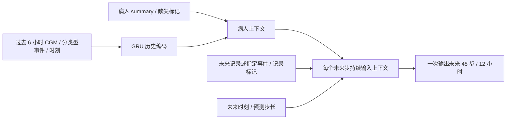

# CGM 预测模型审查与条件预测候选版本

本次目标是检查进食、胰岛素、时刻与病人 summary 是否真正进入预测，并修正可复现的软件问题。候选模型改善了长时段条件预测，但尚未建立“同一病人不进食／不用药”的可信因果反事实。

## 实际发现

1. 旧模型仅有 9 个时间序列特征，未读取 summary。它已有 `hour_sin/hour_cos`；不能说完全没有时间信息。
2. 旧模型训练目标是下一次 15 分钟血糖。3／6／12 小时曲线由连续递推得到，原有约 3.8 mg/dL 的一步测试 MAE 不代表长时段预测准确度。
3. 递推历史窗口存在时间错位：标记为下一时刻的行放入了上一时刻的血糖。已改为放入该时刻的预测血糖，并新增回归测试。
4. 旧特征将皮下注射、静脉注射、泵 bolus（IU）和泵 basal 速率（IU/h）相加，单位与作用方式混在一起。
5. 饮食文本被解析为食物总重量；60 g 食物不等于 60 g 碳水化合物，等重量的不同食物不能视为同一输入。
6. 原始 109 份记录共 112,379 行，112,287 行有可解析 CGM；2,999 行有可解析进食，2,366 行有可解析胰岛素。没有 CGM 的进食行数量为 0；没有 CGM 的胰岛素行数量为 1。因此，大量事件被丢弃不是这批数据上的主要解释。
7. 大量空白／零事件输入不等于经过核实的禁食／未使用胰岛素。不能通过复制样本、把事件改成 0 并沿用实际血糖，就得到真实“无干预”训练标签。

模型的“未来”相对于最后一条 CGM 的时间，不是电脑当前时间。没有新的测量时，仅仅隔一段时间重新打开同一历史记录，不应该凭空生成新的真实病人状态。

## 新候选模型

代码：`models/training/t2dm/conditional_pipeline.py`。



- 直接训练多步 CGM 轨迹，不依赖把自身预测血糖反复作为新观测。
- 分开食物质量、皮下注射、静脉注射、泵 bolus、basal IU/h，保留事件记录标记。
- 事件单独按时间对齐到下一 CGM，最多允许一个短间隔；不跨长时间缺口补事件，不插值伪造 CGM。
- 静态分支默认包含性别、年龄、身高、体重、BMI、吸烟史、糖尿病病程 7 个字段，按完整病人记录 ID 精确关联。
- 缺失值中位数、标准化和输出尺度仅在训练窗口拟合，保存到 checkpoint。身高等小量纲静态变量按实际标准差缩放。
- 每个训练预测窗口的全部 48 个目标都在同一个训练／验证／测试区间内，避免目标跨越边界。
- 部分训练样本隐藏未来事件计划，表示未知未来输入；不把“未知”标成已核实的“无进食／无药物”。
- 通过前向解码结构确保未来事件不会改变事件发生前的预测步，已有测试覆盖。

另有 `--include-undated-labs` 回顾性实验，共纳入 23 个数值字段，包括 HbA1c、空腹／餐后血糖、C 肽、胰岛素、血脂和肾功能。原 summary 没有检测日期；这些值是否在预测起点之前已经获得，需要另外核实。因此该实验不能当作已验证的前瞻预测结果。

## 评估与结果

具体数字见 [EXPERIMENT_RESULTS.md](../models/evaluation/t2dm/conditional_v2/EXPERIMENT_RESULTS.md)。


评估分为两部分：

- 旧模型与候选模型：相同的 108 个预测起点，每份有足够数据的记录取一个固定测试起点，比较同一组真实未来轨迹。旧模型已应用递推错位修正。
- summary 对照：1,422 个测试预测窗口，在相同设置下重新训练“有／无 summary”模型。窗口可能重叠，不是 1,422 名独立病人，也没有验证对未见病人的泛化能力。

只报告这批记录的一次固定种子实验；没有把差异包装成统计显著或临床有效。

## What-if 的界限

预测关联与干预效果是两个任务。原数据含有“血糖高，所以增加胰岛素”这样的治疗选择过程。普通预测网络可能把它学成胰岛素与后续高血糖同向，即使短时血糖预测指标有所改善，也不能因此认定它学到了药效。

候选版本没有人为放大事件系数，也没有强制把所有胰岛素曲线向下调整来制造“有效”的视觉效果。进食和胰岛素响应方向均未通过验证：示例出现进食瞬间下降、bolus 输入后上升；固定起点实验中，约 80% 的进食输入最大变化为负，bolus 输入的最大变化全部为正。因此候选模型尚不能作为可信的生理 What-if 模拟器上线。口服降糖药文本、不同胰岛素制剂的作用持续时间、实际碳水摄入、运动和其他未记录因素也尚未完整建模。

可信的停药／禁食模拟需要明确事件记录的完整程度、治疗种类与作用时间、预测起点可用的信息，以及处理治疗选择混杂的研究设计／假设。可参考：

- [上海糖尿病数据集原始论文](https://www.nature.com/articles/s41597-023-01940-7)：饮食为自报记录，含多种胰岛素给药方式。
- [Counterfactual Recurrent Network 原论文](https://arxiv.org/abs/2002.04083)：针对随时间变化的治疗选择与反事实估计。
- [G-Net 原论文](https://proceedings.mlr.press/v158/li21a.html)：通过时序 g-computation 进行动态治疗方案下的反事实预测。

## 当前状态与复现

- 现有网页仍使用 `models/weights/gru_t2dm_forecaster.pt`；本次修正它的递推实现，没有替换原权重。
- 候选权重为 `models/weights/conditional_gru_v2.pt`，含化验值的回顾性候选为 `conditional_gru_v2_retrospective.pt`。它们使用独立 loader，不能当作旧 checkpoint 填入旧接口。
- 当前 Supabase 训练入口仍是旧版单步训练；候选版本从本地原始记录与 summary 训练。候选结果本次没有写入线上数据库。
- 网页增加曲线最大差异与末端差异的区分，并明确空事件计划和因果效果的区别。

从仓库根目录运行：

```powershell
python -m models.training.t2dm.audit_model
python -m models.training.t2dm.conditional_pipeline --epochs 30 --ablate-static
python -m models.training.t2dm.conditional_pipeline --epochs 30 --include-undated-labs --output-dir models/evaluation/t2dm/conditional_v2/retrospective_labs
python -m models.training.t2dm.compare_conditional
python -m models.training.t2dm.report_conditional
python -m models.training.t2dm.conditional_predict --record-id 2000_0_20201230 --hours 12 --meal-g 60 --minutes-ahead 60
python -m unittest discover -s models/tests -v
```

训练依赖见 `models/training/requirements.txt`；生成图表另外需要 matplotlib（notebook 依赖中也已列出）。候选预测脚本输出 CSV，明确保留为模型输入敏感性示例，不推荐药量。
