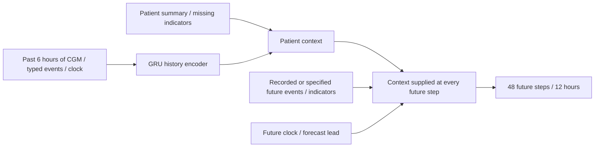
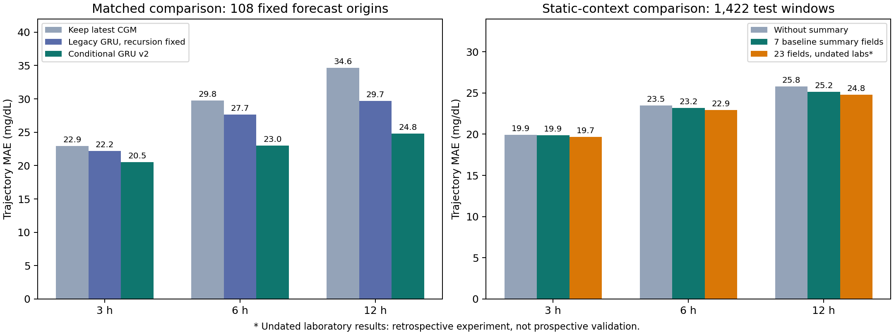
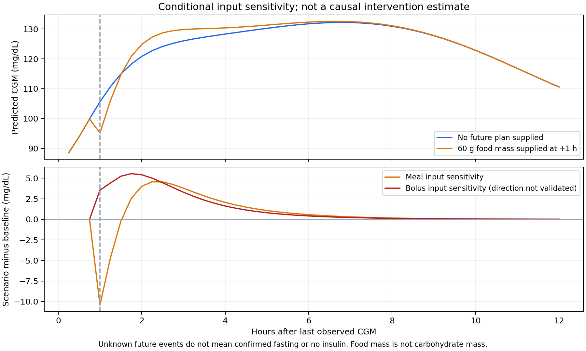

# CGM model audit and conditional forecasting candidate

This audit checks how meals, insulin, time and patient summary features enter forecasts, and fixes reproducible implementation defects. The candidate improves longer-horizon conditional prediction. It does not establish credible causal counterfactuals for the same patient without food or medication.

## Findings

1. The legacy model uses nine time-series features and does not read the summary. It already includes `hour_sin/hour_cos`, so time information is present.
2. Its training target is the next 15-minute glucose reading. The 3-, 6- and 12-hour curves come from recursive predictions. The original one-step test MAE of approximately 3.8 mg/dL does not measure long-horizon accuracy.
3. The recursive history window had a timestamp mismatch: a row stamped with the next timestamp contained the previous glucose value. It now contains the prediction for that timestamp, with regression-test coverage.
4. Legacy features add subcutaneous doses, intravenous doses, pump bolus doses (IU) and pump basal rates (IU/h), mixing units and delivery modes.
5. Dietary text is parsed as total food mass. A 60 g food entry is not 60 g of carbohydrate, and foods of equal mass are not equivalent inputs.
6. The 109 raw records contain 112,379 rows, including 112,287 rows with parseable CGM, 2,999 with parseable meals and 2,366 with parseable insulin. No meal rows and only one insulin row lack CGM. Widespread event loss is therefore not the main explanation in this dataset.
7. Blank or zero event inputs do not establish verified fasting or absence of insulin. Duplicating observations, setting their events to zero and retaining their observed glucose does not produce valid untreated training labels.

A forecast starts after the last observed CGM timestamp, rather than the computer's current time. Reopening the same historical record later, without new measurements, should not invent a new observed patient state.

## Candidate model

Implementation: `models/training/t2dm/conditional_pipeline.py`.



- Train directly on multi-step CGM trajectories instead of repeatedly feeding predicted glucose back as new observations.
- Separate food mass, subcutaneous insulin, intravenous insulin, pump bolus and basal IU/h, retaining event-recording indicators.
- Align events independently to the next CGM within a short permitted interval. Do not carry events across long gaps or interpolate synthetic CGM.
- Use seven default static fields: gender, age, height, weight, BMI, smoking history and diabetes duration. Join using the exact full patient-record ID.
- Fit missing-value medians, normalization and output scales on training windows only, and save them in the checkpoint. Static variables with small units, such as height in metres, use their actual standard deviations.
- Keep all 48 targets of every training, validation or test trajectory inside the same split.
- Hide future event plans for some training examples to represent unknown future inputs. Unknown plans are not labelled as verified fasting or no medication.
- Use a forward decoder so future events cannot change predictions before their occurrence; tests cover this property.

The separate `--include-undated-labs` retrospective experiment uses 23 numeric fields, including HbA1c, fasting/postprandial glucose, C-peptide, insulin, lipids and renal measurements. The summary lacks measurement dates. Availability before each forecast origin remains unverified, so this experiment is not validated prospective prediction.

## Evaluation and results

See [EXPERIMENT_RESULTS.md](../models/evaluation/t2dm/conditional_v2/EXPERIMENT_RESULTS.md) for measurements.





- Legacy versus candidate: the same 108 fixed forecast origins, one per eligible record, evaluated against the same observed future trajectories. The legacy recursion alignment fix is applied.
- Summary ablation: 1,422 test forecast windows, with models retrained under the same settings with and without summary inputs. Windows may overlap; these are not 1,422 independent patients, and unseen-patient generalization has not been evaluated.

These are single-seed experiments on this dataset. Differences are not presented as statistically significant or clinically validated.

## Limits of what-if interpretation

Predictive association and intervention effects are different tasks. The data include treatment selection, such as higher glucose prompting more insulin. A prediction network may learn a positive association between insulin and subsequent high glucose. Improved prediction error alone does not establish learned drug effects.

The candidate does not artificially amplify event coefficients or force insulin curves downward to create an apparent effect. Neither meal nor insulin response direction is validated: the example shows an immediate meal-associated fall and a bolus-associated rise. At the fixed evaluation origins, approximately 80% of meal inputs have a negative signed peak change, while all bolus inputs have positive peak changes. These failures prevent deployment as a credible physiological what-if simulator. Oral medication text, insulin formulation-specific action durations, actual carbohydrate intake, exercise and other unrecorded factors also remain incompletely modelled.

Credible fasting or medication-withholding simulations require established event-recording completeness, treatment types and action times, information availability at the forecast origin, and a research design or assumptions addressing treatment-selection confounding. Relevant sources include:

- [Original Shanghai diabetes dataset paper](https://www.nature.com/articles/s41597-023-01940-7): self-reported dietary records and multiple insulin delivery modes.
- [Counterfactual Recurrent Network paper](https://arxiv.org/abs/2002.04083): time-varying treatment selection and counterfactual estimation.
- [G-Net paper](https://proceedings.mlr.press/v158/li21a.html): temporal g-computation for counterfactual prediction under dynamic treatment plans.

## Current status and reproduction

- The webpage still uses `models/weights/gru_t2dm_forecaster.pt`. Its recursive implementation is fixed; the original weights are unchanged.
- Candidate weights are `models/weights/conditional_gru_v2.pt`; the retrospective candidate including laboratory measurements is `conditional_gru_v2_retrospective.pt`. They require the separate loader and cannot replace legacy checkpoints in the old interface.
- The Supabase training entry point still uses legacy one-step training. The candidate trains from local raw records and summary data. Candidate outputs were not written to the production database during this experiment.
- The webpage distinguishes maximum curve difference from endpoint difference and explains unknown event plans and causal limitations.

Run from the repository root:

```powershell
python -m models.training.t2dm.audit_model
python -m models.training.t2dm.conditional_pipeline --epochs 30 --ablate-static
python -m models.training.t2dm.conditional_pipeline --epochs 30 --include-undated-labs --output-dir models/evaluation/t2dm/conditional_v2/retrospective_labs
python -m models.training.t2dm.compare_conditional
python -m models.training.t2dm.report_conditional
python -m models.training.t2dm.conditional_predict --record-id 2000_0_20201230 --hours 12 --meal-g 60 --minutes-ahead 60
python -m unittest discover -s models/tests -v
```

Training dependencies are listed in `models/training/requirements.txt`. Figure generation additionally requires matplotlib, also listed in the notebook dependencies. The candidate prediction script exports CSV sensitivity examples and does not recommend insulin doses.
