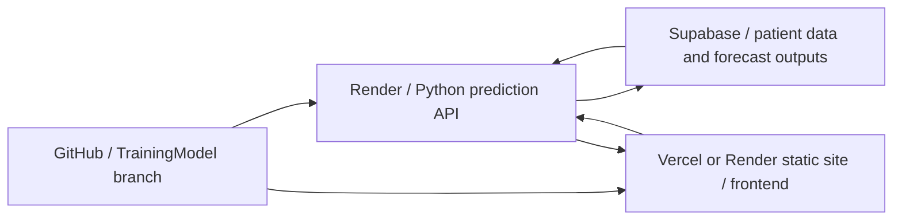

# Prediction service setup: GitHub, Render, Supabase and Vercel

## Temporary browser model (no Render)

The page now defaults to **Repository GRU · browser (no Render)**. It executes the checked-in trained weights in a Web Worker with the exact repository record's history. New 3/6/12-hour forecasts and meal/insulin scenarios run without a model-service URL, model-service login or database write. Repository workbook history is explicitly distinguished from refreshed Supabase observations. See [Browser GRU implementation and checks](browser-gru.md).

Regenerate the browser assets with `python -m models.training.export_browser_gru`, commit `web/frontend/public/browser-model/`, and deploy the `TrainingModel` frontend. The frontend host serves these static assets; it does not need Python or Render for this mode.

### Older static chart preview

The older explicit **Local data preview (no server)** mode uses snapshots from `web/frontend/public/forecast-preview/`. Those snapshots also supply checkpoint-matched historical diagnostics to the browser mode; its forecasts and scenarios are newly calculated.

The preview supports 3-, 6- and 12-hour baseline views and CSV downloads. It does not perform browser-side training or new what-if inference, refresh cloud readings, or save outputs to Supabase. The simulator stays visible but is disabled. Records without a matching snapshot show an explicit unavailable message instead of another patient's data. Snapshot files are public static assets; they contain chart series and record IDs, without account credentials or patient summary fields.

Regenerate the snapshots from the repository root after updating local data or weights:

```powershell
python -m models.training.export_forecast_preview
```

Generation uses the Python training dependencies, but Vercel builds only the frontend and copies the committed snapshots. No Python runtime or new environment variable is required for preview mode. Deploy the `TrainingModel` frontend branch to Vercel to receive this change.

When the API is ready, use **Service connection** to connect and switch to Supabase, or select **Supabase Cloud (online service)** in Data source. Configure `VITE_API_BASE_URL` and `ALLOWED_ORIGINS` as described below for all visitors. Local preview remains an explicit selectable mode; failed online requests do not silently substitute preview data.

GitHub stores the code and trained weights. The frontend can run on Vercel or on the optional Render static site defined in this repository. Render runs the Python prediction API, which reads patient data from Supabase and saves completed forecasts back to Supabase.



The Supabase project URL, Vercel webpage URL and Python service URL are different addresses. A `Supabase: Live` badge confirms the frontend's data connection; it does not confirm that the Python model service is running. The previous live database verification used a local Python backend.

## 1. Deploy the services on Render

The repository-root `render.yaml` defines both production services:

| Service | Render type | Root directory | Build command | Publish/start |
| --- | --- | --- | --- | --- |
| `diabetes-digital-twin-api` | Web service | `.` | CPU PyTorch plus `web/backend/requirements.txt` | Gunicorn on `$PORT` |
| `diabetes-digital-twin-frontend` | Static site | `web/frontend` | `npm ci && npm run build` | `dist` |

The static site also rewrites all routes to `index.html` so React client-side routes work after a refresh. If the services already exist in Render, update their settings to match this table or redeploy them from the Blueprint.

### Frontend static-site settings

For the Render static site, use the repository's `TrainingModel` branch, set **Root Directory** to `web/frontend`, **Build Command** to `npm ci && npm run build`, and **Publish Directory** to `dist`. The Blueprint inherits its selected branch for both services because neither service overrides `branch`. Static sites use `type: web` with `runtime: static` in the Blueprint. Add these frontend environment variables in the service's **Environment** settings:

| Frontend variable | Value |
| --- | --- |
| `VITE_API_BASE_URL` | The deployed Python service origin, without `/api` or a trailing slash. |
| `VITE_SUPABASE_URL` | The Supabase project URL. |
| `VITE_SUPABASE_ANON_KEY` | The Supabase publishable/anon key. |

Do not put the Supabase service-role key in the static site. Vite embeds `VITE_*` values into browser assets, so only the publishable/anon key belongs here.

1. Open the [Render Dashboard](https://dashboard.render.com/) and select **New > Blueprint**.
2. Connect the GitHub repository `AA-4499/FYP-A-Sep-2026`. Grant Render access to the repository if prompted.
3. Select the **TrainingModel** branch and use the repository-root `render.yaml` file.
4. Review the proposed service, instance plan and settings before creating the Blueprint. The checked-in configuration names the service `diabetes-digital-twin-api` and requests the free plan; review the options available in your account.
5. Enter the environment variables below and deploy. For an existing Blueprint, update missing values in the service's **Environment** settings.

| Backend variable | Value |
| --- | --- |
| `SUPABASE_URL` | Your Supabase project URL, such as `https://your-project.supabase.co`. |
| `SUPABASE_KEY` | A server-only Supabase secret or service-role key. The frontend publishable/anon key cannot save forecasts through the protected RPC. |
| `ALLOWED_ORIGINS` | The exact frontend origin on Vercel or Render, such as `https://your-project.vercel.app` or `https://your-frontend.onrender.com`. Separate additional origins with commas; omit paths and trailing slashes. |

The Blueprint prompts for these values because they use `sync: false`. Never commit the secret key or place it in a `VITE_*` variable. The backend also accepts `SUPABASE_SECRET_KEY` and `SUPABASE_SERVICE_ROLE_KEY`; those take precedence over `SUPABASE_KEY` if set.

Keep the root directory at the repository root (`.`). The backend needs the `models/` directory as well as `web/backend/`. The checked-in Blueprint installs CPU PyTorch and the backend requirements, then starts Gunicorn with the port supplied by Render. It runs inference using an existing checkpoint; it does not retrain the model at startup.

See the official [Blueprint deployment guide](https://render.com/docs/infrastructure-as-code), [Blueprint configuration reference](https://render.com/docs/blueprint-spec) and [environment variable guide](https://render.com/docs/configure-environment-variables).

## 2. Check the deployed service

After deployment, copy the actual public service URL from Render. Open:

```text
https://your-model-service.onrender.com/api/health
```

The response should be JSON containing `"status": "healthy"`. This checks API availability; it does not exercise model loading, authentication or Supabase writes. The URL above is a placeholder, not an already deployed service.

For an existing Supabase database, apply `models/training/supabase_forecast_outputs.sql` if it has not already been applied. It installs forecast storage, parent/patient relationships and the `save_glucose_forecast` RPC. See [database and authentication details](training-model-migration.md). Do not recreate or clear the existing patient tables.

## 3. Connect the Vercel frontend

For all visitors:

1. Open the Vercel project's environment variable settings.
2. Set `VITE_API_BASE_URL` to the actual Python service origin, for example `https://your-model-service.onrender.com`.
3. Apply it to the environments you use, including **Preview** for branch deployments and **Production** if needed.
4. Redeploy the frontend. Changing an environment variable does not update an existing build.
5. Include the actual frontend origin in Render's `ALLOWED_ORIGINS`. A preview deployment can have a different origin from production.

Use the service origin only, without `/api`. Keep the frontend's existing Supabase URL and publishable/anon key configuration. See the official [Vercel environment variable guide](https://vercel.com/docs/environment-variables/managing-environment-variables).

For a quick check in one browser, open **Service connection** on the Risk Prediction page, enter the same Python service origin and select **Connect and retry**. This override is saved only in that browser and takes precedence over `VITE_API_BASE_URL`. Clear it to return to the deployment setting.

## 4. Verify a real forecast

Sign in with an authorized Supabase account, open a patient with CGM data and run a forecast using **Supabase Cloud (Live DB)**. A completed forecast should display curves and a successful storage receipt. Confirm the returned run ID in `model_runs` and `glucose_forecasts`, with associated evaluation rows in the training output tables where available.

The webpage still uses the legacy checkpoint `models/weights/gru_t2dm_forecaster.pt`. The conditional model candidates are separate experiments and are not automatically activated by this deployment. See the [model audit](conditional-model-audit.md) for their evaluation and what-if limitations.

## Troubleshooting

| Symptom | What to check |
| --- | --- |
| Model service is not connected | Set `VITE_API_BASE_URL` and redeploy, or use Service connection in the current browser. |
| The address returns HTML instead of prediction JSON | Use the Python service origin, rather than the Vercel webpage or Supabase project URL. |
| Health endpoint does not respond | Check Render deployment/runtime logs and confirm the Blueprint root, build command and start command. |
| Browser reports a CORS failure | Add the exact current frontend origin to `ALLOWED_ORIGINS` on Render and apply the updated environment. |
| Forecast returns 401 or 403 | Sign in again and check the trusted Supabase `app_metadata` role and patient authorization described in the migration guide. A displayed frontend role alone does not grant backend access. |
| Forecast reports a database or RPC failure | Check the backend server key and confirm the forecast SQL migration was applied to the same Supabase project. |
| New frontend configuration seems ignored | Clear an old browser-local Service connection override and confirm a new Vercel deployment used the intended environment. |

On desktop, the main column contains the prediction chart, CGM training/validation/testing history, evaluation details and forecast table. The what-if simulator is on the right. Empty panels remain visible when the service is unavailable; a successful same-selection result is retained during refresh attempts.
