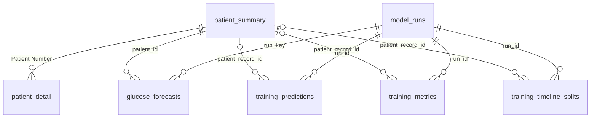

# T2DM training and forecasting: React / Vercel + Python GRU API

The forecasting dashboard lives in the existing **Risk Prediction and What-if Simulation** tab (`web/frontend/src/components/RiskSimulationView.tsx`). It uses the selected patient from the platform header.

## Code locations

- `models/training/t2dm/`: original GRU architecture, preprocessing, temporal splits, local training and inference.
- `models/training/train_from_supabase.py`: offline cloud-data training and optional upload.
- `models/training/supabase_output_tables.sql`: optional training output tables.
- `models/weights/gru_t2dm_forecaster.pt`: supplied 340 KB checkpoint, explicitly included despite the general weights ignore rule.
- `models/evaluation/t2dm/`: supplied evaluation metrics, predictions and timeline split reports.
- `models/tests/`: migrated regression tests.
- `web/backend/services/forecast_service.py`: local/cloud data loading and actual model inference.
- `web/backend/forecast_routes.py`: authenticated `POST /api/patients/<id>/glucose-forecast`.
- `data/raw/t2dm_training/Shanghai_T2DM/`: complete personal training dataset (109 workbooks), used by default. The group dataset at `data/raw/Shanghai_T2DM/` remains unchanged.
- `data/processed/t2dm/cleaned_Shanghai_T2DM_Summary.xlsx`: personal cleaned summary.
- `models/training/t2dm/t2dm_training.ipynb`: migrated training notebook with package imports and cleared stale outputs.
- `models/training/.env`: local training credentials, excluded from Git.

The personal source folder and all compatibility entry points have been removed. No Streamlit runtime or dependency remains.

## Run locally

Run from the repository root with Python 3 (Python 3.11 recommended):

```powershell
python -m pip install -r web/backend/requirements.txt
# models/training/.env provides SUPABASE_URL and the server-only Supabase key.
$env:ALLOWED_ORIGINS = 'http://localhost:3000'
python web/backend/app.py
```

In another terminal:

```powershell
cd web/frontend
npm ci
# Copy .env.example to .env.local and configure the frontend Supabase values.
npm run dev
```

Sign in, select a patient with CGM data, then open **Risk Prediction**. The local workbook selector uses the selected patient's exact filename ID (for example `2017_1_20201118`), while the model internally uses its record ID (`2017_1`). Missing records and discontinuous histories produce explicit errors.

The form supports 3/6/12-hour forecasts, a meal event in grams, an insulin event in units, baseline/scenario comparison, training/validation/test curves and selected-record MAE/RMSE. Changes to event fields take effect when **Run forecast** is pressed. Changing source or horizon returns to a baseline forecast. Event offsets use 15-minute intervals and must precede the final forecast step.

For **Supabase Cloud**, set `SUPABASE_URL` and `SUPABASE_KEY` on the Python server (or `SUPABASE_SERVICE_ROLE_KEY`). The server reads only the exact selected `patient_detail` record, with pagination. These server secrets must never use a `VITE_` prefix. Every successful dashboard forecast is saved to Supabase through a server-only RPC transaction. Both sources evaluate the loaded checkpoint on the selected record; saved predictions from unrelated runs are never mixed in.

### Authentication

The API verifies access tokens with Supabase Auth when `SUPABASE_JWT_SECRET` is absent; this supports asymmetric signing keys without copying a JWT signing secret. An optional configured legacy HS256 secret enables the existing local verifier (audience `authenticated`). Authorization uses trusted `app_metadata` after verification.

The platform has three roles: **Admin**, **Patient**, and **Doctor**. Configure the user's trusted `app_metadata` via the Supabase admin interface/API: `{"role":"doctor"}` (or `admin`) for cohort access; `{"role":"patient","patient_id":"2017_1_20201118"}` for access to one exact record. The generic Supabase JWT role `authenticated` is not a platform role. Editable `user_metadata` does not grant server permissions. Reauthenticate after changing claims.

For existing databases using the old `clinician` role, apply [supabase_doctor_role_migration.sql](supabase_doctor_role_migration.sql) to rename the enum value and update trusted Auth metadata. The frontend and API accept `clinician` as a legacy alias for `doctor`; it is not a separate platform role. Existing assignment table and column names are preserved. Fresh databases use [supabase_phase2.sql](supabase_phase2.sql).

## GitHub branch and Vercel

The existing frontend remains the Vercel project. Configure:

| Setting | Value |
| --- | --- |
| Root Directory | `web/frontend` |
| Framework | Vite |
| Build Command | `npm run build` |
| Output Directory | `dist` |
| Install Command | `npm ci` |
| `VITE_API_BASE_URL` | Your deployed Python API origin, e.g. `https://your-api.onrender.com` (without `/api`) |
| `VITE_SUPABASE_URL` | Your Supabase project URL |
| `VITE_SUPABASE_ANON_KEY` | Your public anonymous/publishable key |

Set the frontend environment variables for **Preview** as well as **Production**. Connect this GitHub repository in Vercel and enable branch deployments. A pushed non-production branch normally creates a Preview; the configured Production Branch controls production deployments. Repository edits cannot configure that account-level Git connection or change the project's Production Branch automatically.

`render.yaml` configures the Python API from the repository root so it can import `models/` and read the checkpoint/data. Set `SUPABASE_URL`, a server-only secret/service-role key, and `ALLOWED_ORIGINS` there. `ALLOWED_ORIGINS` accepts comma-separated exact frontend origins; include the Vercel deployment URL you use, including Preview origins. Cloud data also needs the server Supabase credentials. The backend uses CPU PyTorch; training remains offline and is never run during a Vercel build or page request.

After configuring the connected projects, commit and push this branch through your usual Git workflow. This migration does not create a commit, push, or change remote account settings.

## Retrain and test

```powershell
# From repository root
python -m models.training.t2dm.train_t2dm --epochs 30
python -m models.training.train_from_supabase --epochs 30 --skip-upload
python -m unittest discover -s models/tests -v
python -m unittest discover -s web/backend/tests -p test_forecast_api.py -v
```

Local training writes reports to `models/evaluation/t2dm/` and the production checkpoint to `models/weights/`. Supabase training also writes local reports and weights; remove `--skip-upload` only when you intend to write a new run to the optional output tables. Server cloud training credentials may be supplied through environment variables or `models/training/.env` (with a root `.env` fallback). Existing process environment variables take precedence.

The supplied model forecasts glucose, rather than a validated probability of long-term complications. The new page displays glucose forecasts and measured prediction errors. Training/validation curves are in-sample diagnostics; held-out testing uses rolling one-step predictions, and future simulation uses recursive forecasts. This preserves the original dashboard's research-only scope.

## Notebook

Install `models/training/requirements-notebook.txt`, then open `models/training/t2dm/t2dm_training.ipynb` from within the repository. Run the setup cell first, then the training cell when you intend to retrain. Saved outputs have been cleared.

## Personal data preservation

The personal dataset has 109 workbooks. Three differ from the group files with the same names: `2034_0_20210624.xls`, `2086_0_20200914.xls`, and `2095_0_20201116.xls`. The complete personal set is stored independently so the supplied checkpoint can be evaluated against its original inputs. Temporary Excel lock files and Python bytecode were discarded.

## Live Supabase read, prediction, and storage

Apply `models/training/supabase_forecast_outputs.sql` in the Supabase SQL Editor. It is written for the existing `patient_summary`, `patient_detail`, `training_predictions`, `training_metrics`, and `training_timeline_splits` schema. For a fresh database, create the existing tables with `supabase_output_tables.sql` first. The migration preserves existing result rows, backfills parent runs, and can be rerun.

Relationships:

- `model_runs.run_id` is the parent of the three existing training output tables and `glucose_forecasts.run_key` (generated from the forecast UUID).
- `patient_summary."Patient Number"` remains the parent of `patient_detail` and is the parent of `glucose_forecasts.patient_id` and the three output tables' new nullable `patient_record_id` columns.
- Historical short record IDs are matched only when there is exactly one matching summary record; unresolved rows and cohort metrics (`ALL`) retain a null patient FK. Their original `patient_id` values remain intact.

The default dashboard source is Supabase. Each run reads the selected patient's paginated CGM rows, runs the actual GRU, then calls `save_glucose_forecast`. The RPC saves the parent run, full baseline/scenario and diagnostic curves, held-out actual/predicted points, evaluation metrics, and timeline split together. A failed write rolls back the entire run. Future points stay in `glucose_forecasts.output` because the existing testing table requires a known actual glucose value.

The UI reports success only after a save receipt is validated. A UUID run ID makes retrying the same forecast idempotent; repeated requests do not create duplicate child results. The model checkpoint SHA-256 and scenario events are stored with the result.

For an authorized live verification (this writes one real forecast run):

```powershell
python web/backend/verify_supabase_forecast.py --patient-id 2000_0_20201230 --horizon-hours 3
```

The verifier reads the actual cloud data, saves a forecast, retries it, reads back the full output, and checks embedded foreign-key joins from `model_runs`. It prints the run ID and counts rather than credentials or clinical readings. Server key aliases supported are `SUPABASE_SECRET_KEY`, `SUPABASE_SERVICE_ROLE_KEY`, and `SUPABASE_KEY` (in that priority order). New `sb_secret_` keys are sent through `apikey`, never as JWT bearer tokens. Only the user's verified access token is used for Supabase Auth.

### Verified live run

The live verification run `15e185a6-49f8-450e-abae-1ca9ff0ab938` used patient record `2000_0_20201230` from Supabase (1,339 valid CGM observations). It saved 12 future points in one complete forecast record, 268 held-out predictions, one metric row and one timeline-split row. Full JSON readback matched inference output, repeating the save preserved the same counts, and joins to the run and patient parent records succeeded.

Database relationship overview:



Server key handling follows the [Supabase API key documentation](https://supabase.com/docs/guides/getting-started/api-keys).

## Prediction page layout and deployment connection

The prediction chart is in the main column, the CGM training/validation/testing chart is directly below, and evaluation, forecast values and model details follow. The simulator sits in the right column on desktop. Chart panels remain mounted when the API is unavailable; completed results are retained during same-selection refreshes.

The page provides a browser-local **Service connection** setting. It overrides `VITE_API_BASE_URL` for this browser; clearing it restores the deployment setting. For a step-by-step explanation of Vercel, the Python model service, and Supabase, see [Prediction service setup](prediction-web-setup.md). The Python service must be deployed before the live webpage can compute new forecasts.
